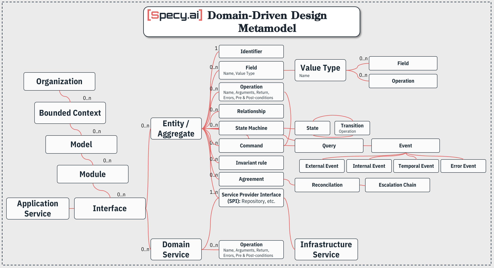

# Specy metamodels

The core of Specy's model-driven, spec-driven development: the five languages, their parsers and the tools that read and write them.

[](./LICENSE)

| Language | File | What it captures |
|---|---|---|
| Product requirements | `.prd` | the *why* and *what*: product, problem, personas, features, stories, releases |
| System requirements | `.sysreq` | the formal *what*: EARS statements, requirement sets, non-functional requirements |
| Domain model | `.domain` | the *how*: bounded contexts, modules, entities, aggregates, values, commands, events, reactions, invariants |
| Software architecture | `.arch` | the *with what*: a C4-inspired system / container / component structure with typed contracts, or an organization's system landscape (level 0) |
| Synthetic-data scenario | `.synth` | the outcomes a dataset must exhibit, written against a `.domain` |

Every model exists in four encodings, **DSL, JSON, YAML and Markdown**, converted without loss by the `specy` CLI. The JSON and YAML forms are described by the JSON Schemas in `src/schemas/`, served at `https://specy.ai/schemas/<name>/1.json`.



## What is here

```
metamodels/
├── src/
│   ├── metamodels/         # The metamodel of each language, in prose (the normative reference)
│   │   ├── PRODUCT-REQ-METAMODEL.md
│   │   ├── SYSTEM-REQ-METAMODEL.md
│   │   ├── DOMAIN-METAMODEL.md
│   │   ├── SOFTWARE-ARCHITECTURE-METAMODEL.md
│   │   ├── SYNTH-METAMODEL.md
│   │   ├── DATA-OPERATION-METAMODEL.md
│   │   ├── ENTERPRISE-ARCHITECTURE-METAMODEL.md   # draft
│   │   └── MODEL-FORMATS.md                       # the contract of the four encodings
│   ├── grammars/           # Canonical EBNF grammars (prd, sysreq, domain, architecture, synth, data-operation)
│   ├── schemas/            # JSON Schemas of the five documents stored as JSON or YAML
│   ├── langium/            # Langium parsers, format converters, LSP server and the specy CLI
│   │   └── specy-domain/
│   ├── tree-sitters/       # Tree-sitter grammars (syntax highlighting, editor tooling)
│   └── diagrams/           # Generators of the metamodel diagrams (repo root *.svg)
├── examples/               # Complete example projects: the acceptance corpus of the parsers
├── specy.sh                # Convert / validate any model between DSL, JSON, YAML and Markdown
├── parse-domain.sh         # Render a .domain to JSON / YAML / Markdown
├── build.sh                # Build orchestrator (langium, tree-sitters, diagrams)
└── VISION.md, CORE_TEAM.md, VISION_TEAM.md, CONSTRUCT_CRITERIA.md   # thesis and review panels
```

## Quick start

```bash
./specy.sh convert examples/ecommerce/v2/orders.domain --to markdown -o   # writes orders.domain.md next to it
./specy.sh convert examples/url-shortener/url-shortener.prd --to yaml
./specy.sh convert sniplink.sysreq.md --to dsl -o sniplink.sysreq         # Markdown -> DSL, through the parser
./specy.sh validate catalogue.synth.yaml                                  # schema + grammar + references into the domain
./specy.sh detect notes.md                                                # which language and encoding it is read as
./specy.sh formats
```

The wrapper builds the CLI on first use (node 20+ and npm required) and works from any directory.

| Command | Description |
|---|---|
| `convert <file> --to dsl\|json\|yaml\|markdown` | Convert between encodings; `-o [file]` writes `<name>.<language>.<ext>` next to the input, `--pretty` indents JSON, `--strict` writes nothing on an error, `--language` / `--from` override the detection |
| `validate <file>` | Any encoding: JSON Schema for json/yaml, the Markdown mapping for md, then grammar, semantic rules and references; `--dsl` prints the DSL a document was checked as |
| `detect <file>` | The language and encoding a file is read as |

File names carry the encoding: `<name>.domain`, `<name>.domain.json`, `<name>.domain.yaml`, `<name>.domain.md` (same for `.prd`, `.sysreq`, `.arch`, `.synth`). Reading JSON, YAML or Markdown always ends in the parser, so a document in any encoding is judged by the same grammar and rules as the DSL. Diagnostics are `file:line:col [severity] (stage) message`.

## Parsers, formats and LSP

[Langium](https://langium.org/)-based parsers for the five languages live in `src/langium/specy-domain/`, on one shared service set, so a `.synth` scenario resolves its dot-paths into the `.domain` it names with `domain-source`. The package provides:

- **One document, four encodings**: `specy convert` and `specy validate`. Markdown follows the conventions of [`MODEL-FORMATS.md`](./src/metamodels/MODEL-FORMATS.md), which a person or a language model can write loosely: the reader transpiles what it recognizes to the DSL, the parser validates it, and what it could not place is reported line by line.
- **Editor integration**: diagnostics, syntax validation and AST navigation through LSP (VS Code extension entry point in `src/extension/main.ts`; Neovim through `vim.lsp.config`). In a `.synth` file an unknown entity, field, state or enum member is an error naming what was expected and the closest candidate.
- **Parser CLI** (`specy-domain`): parses a `.domain` into JSON, YAML or Markdown, or validates it. The JSON opens with `$schema` and a `parser: { name, version }` header, so consumers such as [synthy](https://github.com/specy-ai/synthy) can pin the shape they understand.
- **Scenario CLI** (`specy-synth`): parses a `.synth` against its `domain-source` into the scenario document synthy reads, as JSON or YAML, or validates it. Semantic rules carry the conflict code synthy would raise (`SYN-E006`, …).
- **Browser bundle** (`npm run build:browser`): `out/browser/specy-domain-langium.js`, an IIFE exposing `window.SpecyDomainLangium`, vendored by the [Specy app](https://github.com/specy-ai/app).

### Build

```bash
./build.sh                              # everything available: langium, tree-sitters, diagrams
./src/langium/specy-domain/build.sh     # npm install, langium generate, embed the schemas, tsc,
                                        # validate every example, convert one file per language to
                                        # the four encodings, run the round-trip tests, bundle for the browser
./src/tree-sitters/build.sh             # generate + build the tree-sitter parsers, smoke-test on examples/
./src/tree-sitters/sync-nvim.sh         # register them in Neovim (see TREE-SITTER.md)
./src/diagrams/build.sh                 # regenerate the metamodel diagrams at the repo root
```

### Parse a `.domain` file

```bash
./parse-domain.sh examples/ecommerce/v2/orders.domain -f markdown
./parse-domain.sh examples/ecommerce/v2/orders.domain -f yaml > orders.yaml
./parse-domain.sh examples/ecommerce/v2/orders.domain --pretty
```

| Flag | Description |
|------|-------------|
| `-f, --format <fmt>` | `json` (default), `yaml`, or `markdown` |
| `--pretty` | Pretty-print JSON output |
| `--raw` | Emit the faithful Langium AST (with `$type` discriminators) instead of the clean domain model |

### Parse a `.synth` scenario

```bash
cd src/langium/specy-domain
node out/cli/synth.js validate ../../../examples/ecommerce/v2/orders.synth
node out/cli/synth.js parse ../../../examples/ecommerce/v2/orders.synth --pretty > orders.synth.json
node out/cli/synth.js parse ../../../examples/ecommerce/v2/orders.synth -f yaml > orders.synth.yaml
```

A broken scenario reads like compiler output:

```
orders.synth:12:21 [error SYN-E005] 'totalAmout' is not a member of entity Order. Did you mean 'totalAmount'?
orders.synth:19:9  [error SYN-E008] Mix of Order.OrderLifecycle sum to 0.9, not 1. Make them sum to 1, or omit a member to leave it at 0.
```

## Examples

`examples/` holds complete, fictional Specy projects. They are documentation, the acceptance corpus of the parsers (every file is validated by the Langium build, smoke-tested by the tree-sitter build and round-tripped through the four encodings by the test suite) and the fixtures of the other Specy repos.

| Project | Files |
|---|---|
| `business-loan/` | `.prd`, `.sysreq`, `.domain` |
| `url-shortener/` | `.prd`, `.sysreq`, `.domain`, `.arch` (one system in focus) |
| `retail-media/` | `.domain` + a level-0 `.arch` landscape of an organization |
| `ride-now/` | multi-context ride-sharing: `.prd`, `.sysreq`, `.domain` |
| `ecommerce/v2/` | the orders `.domain` with its `.synth` scenarios, catalogue and vocabularies |
| `conformance/` | `all-constructs.domain`, every construct of the domain grammar |

## The Specy repositories

This repository is the one the others build on. Each expects the others as **sibling checkouts** under one folder (override with the environment variable named):

| Repository | Builds on metamodels for | Location |
|---|---|---|
| [skills](https://github.com/specy-ai/skills) | the Claude Code plugin copies the grammars, metamodels, schemas and examples into each skill at build time | `../metamodels` (`SPECY_METAMODELS`) |
| [app](https://github.com/specy-ai/app) | vendors the browser bundle of the parsers; its check scripts read `examples/` | `../metamodels` (`SPECY_METAMODELS`) |
| [website](https://github.com/specy-ai/website) | publishes the metamodels verbatim at specy.ai/reference and serves the JSON Schemas at their `$id` | `../metamodels` (`SPECY_METAMODELS`) |
| [synthy](https://github.com/specy-ai/synthy) | regenerates its test fixtures from `examples/` with the `specy-domain` CLI and ships a copy of the scenario schema | `../metamodels` (`SPECY_METAMODELS`) |
| [diagram-engine](https://github.com/specy-ai/diagram-engine) | independent: renders the diagrams derived from a model | |

## Contributing

Specy is built in the open. The design philosophy lives in [VISION.md](./VISION.md); changes to a language go through the review panel of [CORE_TEAM.md](./CORE_TEAM.md) and the construct criteria of [CONSTRUCT_CRITERIA.md](./CONSTRUCT_CRITERIA.md). A grammar change goes with its EBNF, its Langium grammar, its tree-sitter grammar and the metamodel prose, and every example must still validate.

## License

MIT — see [LICENSE](./LICENSE).
